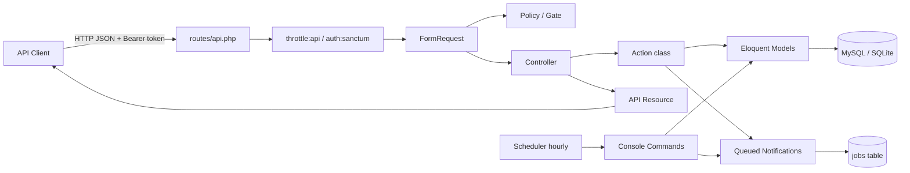
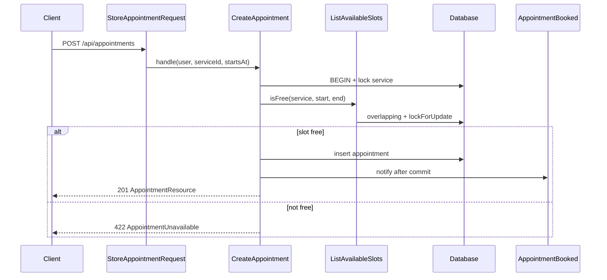
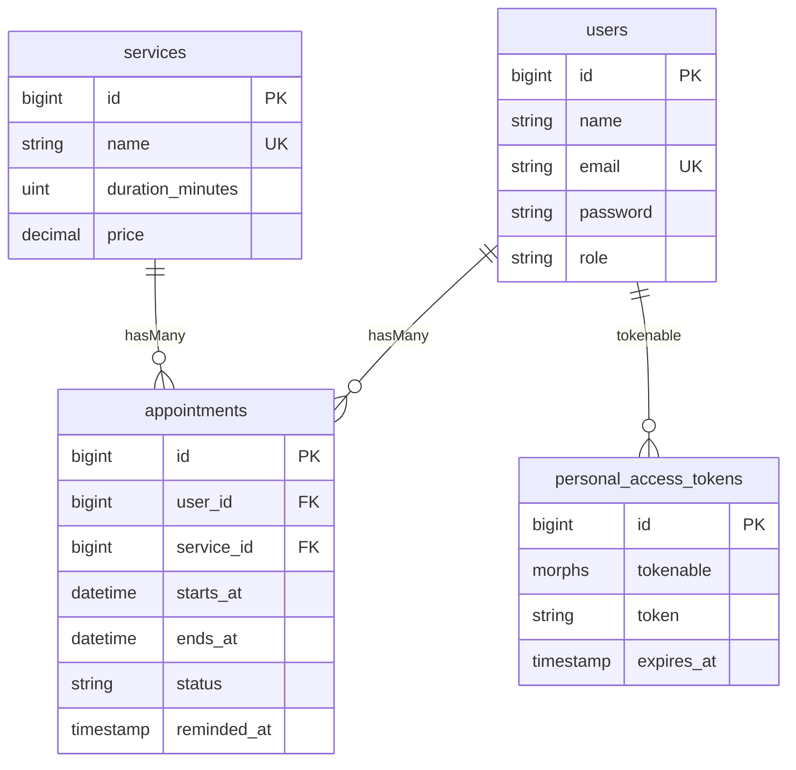

# مستند فنی — Appointment Booking API

> منبع حقیقت: کد موجود در ریپازیتوری. هیچ قابلیت حدس‌زده نشده است.
> تاریخ تحلیل بر اساس وضعیت فعلی پروژه.

---

## 1. Overview

### هدف پروژه
یک **JSON API** برای رزرو نوبت در یک کسب‌وکار کوچک (دادهٔ seed مربوط به آرایشگاه/آرایش مردانه است). فرانت‌اند در این ریپو وجود ندارد؛ کلاینت (موبایل، SPA، Postman و مشابه) از طریق `/api/*` و توکن Sanctum با API صحبت می‌کند.

### کاربران هدف
| نقش | مقدار `role` | توانایی‌ها |
|---|---|---|
| Customer | `customer` | ثبت‌نام، مشاهده سرویس‌ها، دیدن اسلات آزاد، رزرو/جابجایی/لغو نوبت‌های خود |
| Admin | `admin` | همهٔ کارهای مشتری + CRUD سرویس‌ها، دیدن همهٔ نوبت‌ها، آمار ادمین |

### قابلیت‌های اصلی (بر اساس کد)
- ثبت‌نام / ورود / خروج / پروفایل (`AuthController`)
- مدیریت سرویس‌ها (`ServiceController`)
- محاسبه اسلات‌های آزاد (`AvailabilityController` + `ListAvailableSlots`)
- رزرو، لیست، جزئیات، جابجایی، لغو نوبت (`AppointmentController` + Actions)
- آمار ادمین (`AdminStatsController` + `BuildAdminStats`)
- ایمیل تأیید / لغو / جابجایی / یادآوری ۲۴ ساعته (Notifications صف‌شده)
- تکمیل خودکار نوبت‌های گذشته (`appointments:complete-past`)

### Tech stack (نسخه‌های قفل‌شده در `composer.lock`)
| جزء | نسخه |
|---|---|
| PHP | `^8.3` (محیط فعلی مشاهده‌شده: 8.4.x) |
| Laravel Framework | `v13.38.0` |
| Laravel Sanctum | `v4.3.3` |
| Laravel Tinker | `v3.0.2` |
| PHPUnit | `12.5.40` |
| Laravel Pint | `v1.32.1` |
| DB توسعه (طبق README / `.env.example`) | MySQL |
| DB تست (طبق `phpunit.xml`) | SQLite `:memory:` |

---

## 2. Project Structure

```
appointment/
├── app/
│   ├── Actions/                      # منطق کسب‌وکار (یک کلاس per use-case)
│   │   ├── BuildAdminStats.php
│   │   ├── CancelAppointment.php
│   │   ├── CreateAppointment.php
│   │   ├── ListAvailableSlots.php
│   │   └── RescheduleAppointment.php
│   ├── Console/Commands/
│   │   ├── CompletePastAppointments.php   # appointments:complete-past
│   │   └── SendAppointmentReminders.php   # appointments:send-reminders
│   ├── Enums/
│   │   ├── AppointmentStatus.php          # confirmed|cancelled|completed
│   │   └── Role.php                       # admin|customer
│   ├── Exceptions/
│   │   ├── AppointmentUnavailable.php     # → HTTP 422
│   │   └── BookingConflict.php            # → HTTP 409
│   ├── Http/
│   │   ├── Controllers/                   # کنترلرهای نازک
│   │   ├── Requests/                      # FormRequest: validate + authorize
│   │   └── Resources/                     # شکل JSON خروجی
│   ├── Models/                            # User, Service, Appointment
│   ├── Notifications/                     # ایمیل‌های صف‌شده
│   ├── Policies/                          # AppointmentPolicy, ServicePolicy
│   └── Providers/AppServiceProvider.php   # Gate + RateLimiter
├── bootstrap/app.php                      # routing API، throttleApi، JSON errors
├── config/
│   ├── booking.php                        # قوانین کسب‌وکار (ساعات، صفحه، reminder، stats)
│   ├── sanctum.php                        # expiration توکن = ۷ روز
│   └── …                                  # تنظیمات استاندارد Laravel
├── database/
│   ├── factories/
│   ├── migrations/
│   └── seeders/DatabaseSeeder.php
├── docs/
│   ├── PROJECT_OVERVIEW.md                # مرور خلاصه قبلی
│   └── TECHNICAL_DOCUMENTATION.md         # همین فایل
├── floorplan/                             # ابزار visualization کد؛ بخشی از اپ نیست
├── public/index.php                       # front controller
├── routes/
│   ├── api.php                            # همهٔ endpointها
│   └── console.php                        # Schedule ساعتی
├── tests/
│   ├── Feature/                           # تست‌های HTTP / جریان‌ها
│   └── Unit/EnumTest.php
├── artisan
├── composer.json
├── phpunit.xml
└── README.md
```

**نکته:** فایل `routes/web.php` وجود ندارد. فقط API + health (`/up`) + console schedule.

---

## 3. Architecture

### الگوی معماری
**Laravel MVC + thin controllers + Action classes** برای منطق غیرساده، همراه با:

- FormRequest برای اعتبارسنجی و بخشی از authorize
- Policy / Gate برای مجوز
- API Resource برای خروجی JSON
- Enum برای `role` و `status`
- Notification صف‌شده برای ایمیل

CRUD سادهٔ سرویس‌ها در خود `ServiceController` مانده و Action جدا ندارد (طبق سبک پروژه).

### اجزای اصلی و تعامل



### جریان رزرو (نمونه end-to-end)

`POST /api/appointments` با `{ "service_id": 1, "starts_at": "2026-11-10 09:45:00" }`

1. `routes/api.php` → `AppointmentController@store` داخل گروه `auth:sanctum`
2. `StoreAppointmentRequest`: `AppointmentPolicy::create` + قوانین `service_id` / `starts_at`
3. `CreateAppointment::handle()` داخل `DB::transaction`:
   - `Service::lockForUpdate()`
   - `ListAvailableSlots::isFree()` (گرید ساعات + overlap با `Appointment::overlapping()` + `lockForUpdate` روی ردیف‌های تداخلی)
   - در صورت عدم آزادی → `AppointmentUnavailable` (422)
   - ایجاد نوبت با `status = confirmed` و صف کردن `AppointmentBooked`
4. پاسخ `201` با `AppointmentResource` (شامل `service` و `user`)



---

## 4. Database

### جداول دامنه

#### `users`
| Column | Type / notes |
|---|---|
| `id` | bigint PK |
| `name` | string |
| `email` | string, **unique** |
| `email_verified_at` | timestamp nullable (API از آن استفاده نمی‌کند) |
| `password` | string (cast: hashed) |
| `role` | string, default `customer` |
| `remember_token` | string nullable (API از آن استفاده نمی‌کند) |
| `timestamps` | created_at / updated_at |

Migration: `database/migrations/0001_01_01_000000_create_users_table.php`

#### `services`
| Column | Type / notes |
|---|---|
| `id` | bigint PK |
| `name` | string, **unique** (migration `2026_11_04_120000_add_unique_name_to_services_table.php`) |
| `duration_minutes` | unsignedInteger — طول اسلات هم هست |
| `price` | decimal(10,2) |
| `timestamps` | |

Migration پایه: `database/migrations/2026_10_26_201538_create_services_table.php`

#### `appointments`
| Column | Type / notes |
|---|---|
| `id` | bigint PK |
| `user_id` | FK → users, **restrictOnDelete** |
| `service_id` | FK → services, **restrictOnDelete** |
| `starts_at` | dateTime |
| `ends_at` | dateTime (`starts_at + duration_minutes`) |
| `status` | string, default `confirmed` |
| `reminded_at` | timestamp nullable |
| `timestamps` | |

Index: `(service_id, starts_at, ends_at)` برای جستجوی overlap.

Migrations:
- `database/migrations/2026_10_26_201539_create_appointments_table.php`
- `database/migrations/2026_10_30_120000_add_reminded_at_to_appointments_table.php`

### جداول فریم‌ورک
| جدول | نقش در این پروژه |
|---|---|
| `personal_access_tokens` | توکن‌های Sanctum |
| `password_reset_tokens` | اسکلت Laravel؛ endpoint ریست پسورد در API نیست |
| `sessions` | طبق `.env.example` ممکن است برای session driver استفاده شود؛ auth API مبتنی بر Bearer است |
| `cache`, `cache_locks` | وقتی `CACHE_STORE=database` |
| `jobs`, `job_batches`, `failed_jobs` | صف database برای نوتیفیکیشن‌ها |

### روابط



### Scopes مهم (`App\Models\Appointment`)
| Scope | کار |
|---|---|
| `overlapping($serviceId, $start, $end, $exceptId?)` | نوبت‌های غیر `cancelled` همان سرویس که با بازه تداخل دارند |
| `visibleTo($user)` | ادمین: همه؛ مشتری: فقط خودش |
| `filtered($filters)` | فیلترهای `status`, `service_id`, `from`, `to` |
| `futureConfirmed()` | نوبت‌های confirmed با `starts_at > now()` |

### Seeder (`Database\Seeders\DatabaseSeeder`)
| رکورد | جزئیات |
|---|---|
| Admin | `admin@example.com` / password از factory (`password`) / role admin |
| Customer | `customer@example.com` |
| Services | Haircut 45min/$80، Beard trim 30min/$40، Haircut and beard 75min/$110 |

---

## 5. API / Routes

پایه: `/api` (پیشوند پیش‌فرض Laravel).  
تعریف: `routes/api.php`  
Middleware سراسری API: `throttle:api` (۶۰ درخواست/دقیقه per user یا IP) از `bootstrap/app.php` + `AppServiceProvider`.

خطاهای `api/*` همیشه JSON رندر می‌شوند (`bootstrap/app.php`).

### Auth

| Method | URL | Middleware | Handler | Auth | Request / Validation | Response |
|---|---|---|---|---|---|---|
| POST | `/api/register` | (api throttle) | `AuthController@register` | guest | `RegisterRequest`: `name` required string max 255؛ `email` unique؛ `password` confirmed + `Password::defaults()` | `201` — `UserResource` + `token` |
| POST | `/api/login` | `throttle:login` (۵/دقیقه per email\|IP) | `AuthController@login` | guest | `LoginRequest`: email, password | `200` — user + token؛ پسورد اشتباه → `422` روی `email` |
| POST | `/api/logout` | `auth:sanctum` | `AuthController@logout` | required | — | `204` No Content؛ توکن فعلی حذف می‌شود |
| GET | `/api/me` | `auth:sanctum` | `AuthController@me` | required | — | `200` — `UserResource` |

نمونه شکل user:

```json
{
  "data": {
    "id": 1,
    "name": "Sample Customer",
    "email": "customer@example.com",
    "role": "customer"
  },
  "token": "1|..."
}
```

(`token` فقط در register/login داخل `additional` است.)

### Services

| Method | URL | Auth / Policy | Handler | Validation | Response |
|---|---|---|---|---|---|
| GET | `/api/services` | sanctum + `ServicePolicy::viewAny` | `index` | — | collection `ServiceResource` |
| GET | `/api/services/{service}` | sanctum + `view` | `show` | — | یک سرویس |
| POST | `/api/services` | admin (`create`) | `store` | `StoreServiceRequest` | `201` |
| PUT/PATCH | `/api/services/{service}` | admin (`update`) | `update` | `UpdateServiceRequest` | `200` |
| DELETE | `/api/services/{service}` | admin (`delete`) | `destroy` | — | `204`؛ اگر هر نوبتی (حتی تاریخی) داشته باشد → `409` |

قوانین سرویس:
- `name`: required, string, max 255, unique (در update با ignore خود رکورد)
- `duration_minutes`: integer, min 1, max 1440
- `price`: numeric, min 0, decimal 0–2 places, max 99999999.99

`ServiceResource`:

```json
{ "id": 1, "name": "Haircut", "duration_minutes": 45, "price": "80.00" }
```

### Availability

| Method | URL | Auth | Handler | Validation | Response |
|---|---|---|---|---|---|
| GET | `/api/services/{service}/availability?date=YYYY-MM-DD` | sanctum + `ServicePolicy::view` | `AvailabilityController` (invokable) | `AvailabilityRequest`: `date` required `Y-m-d` | `{ "data": [ { "starts_at": ISO8601, "ends_at": ISO8601 }, ... ] }` |

### Appointments

| Method | URL | Auth / Policy | Handler | Validation | Response |
|---|---|---|---|---|---|
| GET | `/api/appointments` | sanctum + `viewAny` | `index` | `IndexAppointmentRequest`: optional `status` (enum), `service_id` exists, `from`/`to` `Y-m-d`، `to` ≥ `from` | paginated `AppointmentResource` (۱۵ per page از `config('booking.appointments_per_page')`) |
| POST | `/api/appointments` | sanctum + `create` | `store` → `CreateAppointment` | `service_id` exists؛ `starts_at` `Y-m-d H:i:s` یا `Y-m-d H:i` (بدون offset) | `201` |
| GET | `/api/appointments/{appointment}` | owner یا admin (`view`) | `show` | — | `200` |
| PATCH | `/api/appointments/{appointment}` | owner یا admin (`reschedule`) | `reschedule` → `RescheduleAppointment` | `starts_at` همان فرمت | `200`؛ غیر confirmed → `409`؛ اسلات نامعتبر → `422` |
| POST | `/api/appointments/{appointment}/cancel` | owner یا admin (`cancel`) | `cancel` → `CancelAppointment` | — | `200`؛ غیر confirmed → `409` |

`AppointmentResource` (با روابط لودشده):

```json
{
  "id": 1,
  "user_id": 2,
  "service_id": 1,
  "starts_at": "2026-11-10T09:45:00+00:00",
  "ends_at": "2026-11-10T10:30:00+00:00",
  "status": "confirmed",
  "service": { "...": "..." },
  "user": { "...": "..." }
}
```

### Admin

| Method | URL | Auth | Handler | Response |
|---|---|---|---|---|
| GET | `/api/admin/stats` | sanctum + Gate `view-admin-stats` (فقط admin) | `AdminStatsController` → `BuildAdminStats` | `{ "data": { by_status, bookings_per_day, top_services, cancellation_rate } }` |

### کدهای وضعیت رایج
| Status | معنی در این پروژه |
|---|---|
| 401 | بدون توکن / توکن نامعتبر یا منقضی |
| 403 | لاگین شده ولی مجاز نیست |
| 404 | مدل پیدا نشد (route model binding) |
| 409 | `BookingConflict` |
| 422 | validation یا `AppointmentUnavailable` |
| 429 | rate limit |

---

## 6. Core Modules & Business Logic

### 6.1 `ListAvailableSlots` (`app/Actions/ListAvailableSlots.php`)
**مسئولیت:** ساخت گرید اسلات‌های یک روز و فیلتر اسلات‌های گرفته‌شده؛ همچنین اعتبارسنجی یک زمان مشخص (`isFree`).

**ورودی:** `Service`, روز/`startsAt`، اختیاری `Appointment` برای ignore در reschedule.  
**خروجی `on()`:** لیست `{starts_at, ends_at}`.  
**خروجی `isFree()`:** bool.

**قوانین (از `config/booking.php` + مدت سرویس):**
- فقط `open_weekdays` (پیش‌فرض Mon–Fri = ISO 1–5)
- از `opens_at` تا `closes_at` (پیش‌فرض 09:00–17:00) با قدم‌های `duration_minutes`
- فقط اسلات‌هایی که هنوز شروع نشده‌اند (`isFuture`)
- overlap فقط برای **همان سرویس** (تصمیم محصول: سرویس‌های مختلف می‌توانند هم‌زمان رزرو شوند)
- appointmentهای `cancelled` در overlap حساب نمی‌شوند

**وابستگی‌ها:** Eloquent `Appointment`, config `booking.*`

### 6.2 `CreateAppointment`
**مسئولیت:** رزرو اتمیک.  
**Edge cases:** قفل ردیف سرویس برای جلوگیری از double-booking؛ اسلات خارج گرید / گذشته / تداخلی → `AppointmentUnavailable`.

### 6.3 `RescheduleAppointment`
**مسئولیت:** جابجایی نوبت confirmed.  
قفل سرویس + قفل خود appointment؛ در overlap خودش را ignore می‌کند.  
فقط `confirmed`؛ وگرنه `BookingConflict`.  
با تغییر زمان، `reminded_at` را `null` می‌کند تا یادآوری دوباره ارسال شود.

### 6.4 `CancelAppointment`
**مسئولیت:** وضعیت را به `cancelled` تغییر می‌دهد و `AppointmentCancelled` را notify می‌کند.  
فقط از `confirmed`. داخل transaction با `lockForUpdate` روی ردیف نوبت.

### 6.5 `BuildAdminStats`
خروجی:
- `by_status`: شمارش برای همهٔ مقادیر enum
- `bookings_per_day`: پنجرهٔ `stats_days` (پیش‌فرض ۳۰) بر اساس `created_at`
- `top_services`: top N بر اساس `top_services` config (پیش‌فرض ۵)
- `cancellation_rate`: `cancelled / total` با ۴ رقم اعشار؛ اگر total=0 → `0.0`

### 6.6 Console Commands
| Command | کلاس | رفتار |
|---|---|---|
| `appointments:send-reminders` | `SendAppointmentReminders` | confirmed، `reminded_at` null، `starts_at` بین now و now+`reminder_hours`؛ داخل transaction مقدار `reminded_at` ست و نوتیف صف می‌شود |
| `appointments:complete-past` | `CompletePastAppointments` | confirmed با `ends_at <= now` → `completed` |

### 6.7 Exceptions
| کلاس | HTTP | کاربرد |
|---|---|---|
| `AppointmentUnavailable` | 422 + `errors.starts_at` | اسلات آزاد نیست |
| `BookingConflict` | 409 + `message` | وضعیت فعلی اجازه عمل نمی‌دهد |

---

## 7. Authentication & Authorization

### روش احراز هویت
- **Laravel Sanctum** personal access tokens (`User` uses `HasApiTokens`)
- هدر: `Authorization: Bearer <token>`
- نام توکن ساخته‌شده: `api` (`AuthController::tokenResponse`)
- انقضا: `config/sanctum.php` → `'expiration' => 60 * 24 * 7` (۷ روز)
- Logout فقط توکن فعلی را حذف می‌کند

### نقش‌ها
Enum `App\Enums\Role`: `Admin`, `Customer`.  
`User::isAdmin()` تنها نقطهٔ تشخیص ادمین بودن است.  
`role` در `$fillable` نیست تا از mass assignment از request جلوگیری شود.

### Policies
| Policy | قوانین |
|---|---|
| `AppointmentPolicy` | `viewAny`/`create`: همهٔ کاربران لاگین‌شده؛ `view`/`cancel`/`reschedule`: owner یا admin |
| `ServicePolicy` | `viewAny`/`view`: همهٔ لاگین‌شده‌ها؛ `create`/`update`/`delete`: فقط admin |

### Gate
- `view-admin-stats` در `AppServiceProvider` → `$user->isAdmin()`

### Rate limiting
| Limiter | تعریف | کاربرد |
|---|---|---|
| `api` | 60/min by user id یا IP | همهٔ API via `throttleApi()` |
| `login` | 5/min by `strtolower(email)|ip` | فقط `POST /login` |

ثبت‌نام throttle اختصاصی ندارد (فقط throttle عمومی API).

---

## 8. Configuration & Environment

### متغیرهای مرتبط در `.env.example`

| Variable | مثال / پیش‌فرض | نقش در این پروژه |
|---|---|---|
| `APP_NAME` | Laravel | نام اپ / فرستنده ایمیل |
| `APP_ENV` | local | محیط |
| `APP_KEY` | (خالی تا generate) | رمزنگاری |
| `APP_DEBUG` | true | نمایش خطا |
| `APP_URL` | http://localhost:8000 | URL پایه |
| `APP_LOCALE` / `APP_FALLBACK_LOCALE` / `APP_FAKER_LOCALE` | en / en / en_US | زبان |
| `APP_MAINTENANCE_DRIVER` | file | maintenance |
| `BCRYPT_ROUNDS` | 12 | hashing (در تست‌ها 4) |
| `LOG_*` | stack/single/debug | لاگ |
| `DB_CONNECTION` | mysql | درایور |
| `DB_HOST` / `DB_PORT` / `DB_DATABASE` / `DB_USERNAME` / `DB_PASSWORD` | 127.0.0.1 / 3306 / appointment_booking / root / (خالی) | اتصال DB؛ برای concurrency test نام DB باید به `_test` ختم شود |
| `SESSION_DRIVER` | database | session (auth API عمدتاً token است) |
| `SESSION_LIFETIME` | 120 | دقیقه |
| `QUEUE_CONNECTION` | database | صف نوتیفیکیشن‌ها |
| `CACHE_STORE` | database | کش |
| `MAIL_MAILER` | log | در local ایمیل‌ها به لاگ می‌روند |
| `MAIL_HOST` / `MAIL_PORT` / … | 127.0.0.1:2525 | تنظیمات SMTP در صورت تغییر mailer |
| `MAIL_FROM_ADDRESS` / `MAIL_FROM_NAME` | hello@example.com / APP_NAME | فرستنده |
| `BROADCAST_CONNECTION` | log | broadcasting (استفادهٔ دامنه مشاهده نشد) |
| `FILESYSTEM_DISK` | local | فایل |
| `REDIS_*` | … | در صورت استفاده از redis (پیش‌فرض پروژه database است) |
| `AWS_*` | … | اسکلت Laravel؛ استفادهٔ دامنه مشاهده نشد |
| `VITE_APP_NAME` | ${APP_NAME} | اسکلت؛ فرانت در ریپو نیست |
| `SANCTUM_STATEFUL_DOMAINS` | (اختیاری، در config) | SPA cookie auth؛ این API از Bearer استفاده می‌کند |
| `SANCTUM_TOKEN_PREFIX` | (اختیاری) | پیشوند توکن |

Timezone از `APP_TIMEZONE` خوانده می‌شود (`config/app.php` → `env('APP_TIMEZONE', 'UTC')`؛ در `.env.example` هم هست).

### `config/booking.php`
| Key | Default | معنی |
|---|---|---|
| `opens_at` | `09:00` | شروع روز کاری |
| `closes_at` | `17:00` | پایان روز کاری |
| `open_weekdays` | `[1,2,3,4,5]` | ISO-8601 (دوشنبه=1) |
| `appointments_per_page` | `15` | صفحهٔ لیست نوبت |
| `reminder_hours` | `24` | پنجرهٔ یادآوری |
| `stats_days` | `30` | پنجرهٔ bookings_per_day |
| `top_services` | `5` | تعداد برترین سرویس‌ها |

### سرویس‌های ثالث
- ارسال ایمیل از طریق mailer لاراول (پیش‌فرض `log`؛ قابل تعویض به SMTP و غیره)
- هیچ SDK پرداخت، نقشه، یا سرویس خارجی دیگری در کد دامنه استفاده نشده است

---

## 9. Dependencies

### Production (`composer.json` require)
| Package | Version constraint / locked | دلیل استفاده |
|---|---|---|
| `php` | `^8.3` | زبان اجرا |
| `laravel/framework` | `^13.17` / locked `v13.38.0` | فریم‌ورک HTTP، Eloquent، queue، mail، schedule |
| `laravel/sanctum` | `^4.3` / `v4.3.3` | API token auth |
| `laravel/tinker` | `^3.0` / `v3.0.2` | REPL توسعه |

### Development
| Package | Locked | دلیل |
|---|---|---|
| `phpunit/phpunit` | `12.5.40` | تست |
| `laravel/pint` | `v1.32.1` | فرمت کد |
| `fakerphp/faker` | `v1.24.1` | دادهٔ ساختگی factories |
| `mockery/mockery` | (dev) | mocking (در تست‌های فعلی استفادهٔ سنگین دیده نشد) |
| `nunomaduro/collision` | (dev) | گزارش خطای CLI |
| `laravel/pail` | (dev) | tail لاگ |
| `laravel/pao` | (dev) | ابزار dev لاراول |

وابستگی‌های transitive مهم از طریق Laravel (مثل Carbon، Symfony components، Guzzle) به‌صورت غیرمستقیم می‌آیند.

---

## 10. Background Jobs, Events, Queues, Schedulers, Caching

### Queue
- پیش‌فرض: `QUEUE_CONNECTION=database`
- نوتیفیکیشن‌های نوبت از `AppointmentNotification` ارث می‌برند که `ShouldQueue` + `ShouldQueueAfterCommit` را پیاده می‌کند → ایمیل فقط بعد از commit تراکنش صف می‌شود
- کانال: فقط `mail` (`via()`)
- کلاس‌ها: `AppointmentBooked`, `AppointmentRescheduled`, `AppointmentCancelled`, `AppointmentReminder`
- بدون worker، جاب‌ها در جدول `jobs` می‌مانند (`php artisan queue:work`)

### Scheduler (`routes/console.php`)
```php
Schedule::command('appointments:send-reminders')->hourly();
Schedule::command('appointments:complete-past')->hourly();
```
- توسعه: `php artisan schedule:work`
- پروداکشن: cron برای `php artisan schedule:run`

### Events / Listeners دامنه
کلاس Event/Listener سفارشی دامنه در `app/` مشاهده نشد؛ جریان از طریق notify مستقیم و Command است.

### Caching
- `.env.example`: `CACHE_STORE=database`
- تست‌ها: `array`
- کش دامنهٔ کسب‌وکار (مثلاً cache کردن availability) در کد Actions دیده نشد

---

## 11. Setup & Run

### پیش‌نیاز
- PHP 8.3+
- Composer
- MySQL (InnoDB برای row lock در double-booking)
- (اختیاری) Redis اگر بخواهید queue/cache را عوض کنید

### نصب
```bash
composer install
cp .env.example .env
php artisan key:generate
# دیتابیس MySQL با نام DB_DATABASE را بسازید
php artisan migrate --seed
php artisan serve
```

ترمینال دوم برای ایمیل‌ها:
```bash
php artisan queue:work
```

Scheduler:
```bash
php artisan schedule:work
```

Health check: `GET /up`

### حساب‌های seed
| Email | Password | Role |
|---|---|---|
| `admin@example.com` | `password` | admin |
| `customer@example.com` | `password` | customer |

### Deployment (بر اساس قراردادهای استاندارد Laravel + آنچه در README آمده)
دستور deployment اختصاصی (Docker/Forge/CI) در ریپو مشاهده نشد. حداقل‌های عملیاتی قابل استنباط:
1. `composer install --no-dev --optimize-autoloader`
2. تنظیم `.env` پروداکشن (`APP_DEBUG=false`, mail واقعی، DB پایدار)
3. `php artisan migrate --force`
4. web server → `public/`
5. process برای `queue:work`
6. cron: `* * * * * php artisan schedule:run`
7. `php artisan config:cache` / `route:cache` در پروداکشن متداول است (اسکریپت اختصاصی در ریپو نیست)

---

## 12. Testing

### انواع تست
| نوع | مسیر | پوشش تقریبی |
|---|---|---|
| Feature | `tests/Feature/*` | auth، services، availability، booking، appointment management/index، notifications، reminders، complete-past، admin stats، seeder، domain/schema، concurrency (MySQL) |
| Unit | `tests/Unit/EnumTest.php` | مقادیر enum Role و AppointmentStatus |

### اجرای تست‌ها
```bash
php artisan test
./vendor/bin/pint
```

تست همزمانی (گروه `mysql`، نیاز به MySQL واقعی و `DB_DATABASE` ختم‌شده به `_test`؛ چون `migrate:fresh` می‌زند):
```bash
DB_CONNECTION=mysql DB_DATABASE=appointment_booking_test php artisan test --group=mysql
```

### محیط تست (`phpunit.xml`)
- SQLite memory
- `MAIL_MAILER=array`
- `QUEUE_CONNECTION=sync` (به‌جز تست‌هایی که صراحتاً database queue را می‌سنجند)
- `CACHE_STORE=array` / `SESSION_DRIVER=array`

### نتیجه اجرای مشاهده‌شده
روی محیط تحلیل: **91** تست، **90** پاس، **1** skip (`ConcurrentBookingTest` بدون MySQL `_test`)، حدود **301** assertion.

### Coverage
تنظیم `<source><include>app</include></source>` در PHPUnit هست، اما گزارش coverage تولیدشده/آستانه در ریپو مشاهده نشد → **Unknown / Needs confirmation** برای درصد پوشش واقعی.

فایل‌های تست Feature (نام‌های متد توصیف‌گر رفتار هستند)، از جمله:
- `AuthTest`, `ServiceTest`, `AvailabilityTest`, `BookingTest`
- `AppointmentManagementTest`, `AppointmentIndexTest`
- `NotificationTest`, `SendAppointmentRemindersTest`, `CompletePastAppointmentsTest`
- `AdminStatsTest`, `SeederTest`, `DomainTest`, `ConcurrentBookingTest`

---

## 13. Code Quality Review

مرتب‌شده بر اساس شدت (بر اساس کد خوانده‌شده؛ exploit کامل ادعا نشده):

| Severity | موضوع | مسیر | پیشنهاد |
|---|---|---|---|
| Low | README/`docs/PROJECT_OVERVIEW.md` هنوز می‌گوید unique بودن نام سرویس فقط در validation است؛ در حالی که migration یونیک DB اضافه شده | `README.md`, `docs/PROJECT_OVERVIEW.md`, migration `2026_11_04_...` | مستند را با کد هم‌تراز کنید |
| Low | ثبت‌نام فقط تحت throttle عمومی API است (نه limiter سخت‌گیرانه مثل login)؛ امکان ساخت حساب‌های زیاد با IPهای مختلف همچنان باز است | `routes/api.php` | در صورت نیاز `throttle` اختصاصی برای register |
| Info | هیچ frontend / API versioning / OpenAPI spec در ریپو نیست | — | برای مصرف کلاینت، OpenAPI اختیاری است |
| Info | تست concurrency به‌طور پیش‌فرض skip می‌شود | `ConcurrentBookingTest` | در CI یک job MySQL با `--group=mysql` اضافه کنید |
| Info | tech debt اندک و عمداً ساده نگه داشته شده (بدون Repository/DTO) — با قوانین پروژه هم‌خوان است | — | حفظ KISS |
| Info | قفل ردیف سرویس رزروهای همان سرویس را سریال می‌کند؛ در مقیاس کوچک قابل قبول است | `CreateAppointment`, `RescheduleAppointment` | در رشد، قفل ظریف‌تر (مثلاً روی بازهٔ زمانی) در نظر بگیرید |

نکات مثبت قابل ذکر:
- جلوگیری از double-booking با `lockForUpdate`
- `role` غیر fillable
- نوتیفیکیشن‌ها `ShouldQueueAfterCommit`
- Policy/Gate واضح
- مجموعه Feature test گسترده با نام‌های خوانا

---

## 14. Open Questions

مواردی که از کد به‌تنهایی قطعی نشد:

1. **محیط پروداکشن واقعی** (هاست، Docker، CI/CD، دامنه، mailer واقعی) — در ریپو تعریف نشده.
2. **درصد coverage واقعی تست‌ها** — گزارش coverage ذخیره نشده.
3. **تأیید ایمیل / فراموشی رمز / refresh token** — پیاده‌سازی نشده؛ آیا عمدی است؟
4. **نقش `floorplan/`** — ابزار کمکی visualization است؛ Unknown که آیا برای delivery نگه داشته می‌شود.
5. **نسخه دقیق PHP هدف پروداکشن** — constraint `^8.3` است؛ محیط تحلیل 8.4 بود.
6. **آیا Sanctum stateful/SPA cookie mode استفاده خواهد شد؟** — الان جریان اصلی Bearer token است.
7. **مقادیر قیمت واحد پول** — فیلد `price` بدون currency؛ واحد پول Unknown / Needs confirmation.

تصمیم‌های بسته‌شده:
- **Overlap فقط per-service** — عمدی است؛ سرویس‌های مختلف می‌توانند هم‌زمان رزرو شوند.
- **Timezone** — از `APP_TIMEZONE` قابل تنظیم است (پیش‌فرض UTC).
- **`reminded_at` پس از reschedule** — ریست می‌شود.
- **حذف سرویس/کاربر** — FKها `restrictOnDelete`؛ حذف سرویس با هر تاریخچهٔ نوبت بلاک می‌شود.

---

## پیوست: نقشهٔ سریع کلاس‌ها

| لایه | کلاس‌های کلیدی |
|---|---|
| Controllers | `AuthController`, `ServiceController`, `AvailabilityController`, `AppointmentController`, `AdminStatsController` |
| Actions | `CreateAppointment`, `RescheduleAppointment`, `CancelAppointment`, `ListAvailableSlots`, `BuildAdminStats` |
| Models | `User`, `Service`, `Appointment` |
| Policies | `AppointmentPolicy`, `ServicePolicy` |
| Resources | `UserResource`, `ServiceResource`, `AppointmentResource` |
| Commands | `SendAppointmentReminders`, `CompletePastAppointments` |
| Enums | `Role`, `AppointmentStatus` |
